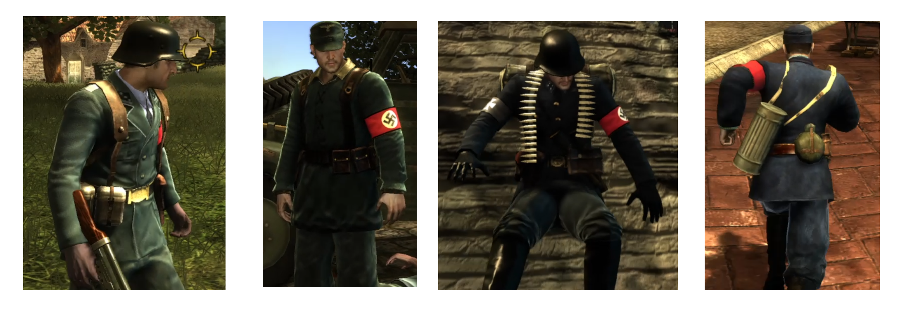

# Sean's Outfit Swap for The Saboteur



Every disguise now wears the soldier's real uniform — tunic, collar, tie and gear — instead of Sean's own
open-shirted clothes.

The shipped game gives Sean a *Sean-fitted* tunic in all 20 disguise sets: it is his silhouette with a Nazi
armband, not the uniform the soldier he knocked out was wearing. This mod swaps the 24 body parts that make
that difference and copies the soldier's tunic, trouser and gear models into each disguise bundle, so the
change is safe on a save load instead of hanging the Continue screen.

| | before | after |
|---|---|---|
| Wehrmacht grunt disguise | Sean's open shirt, Sean's collar | the soldier's tunic with collar and tie |
| SS / GS / KM / LF sets | Sean's tunic, `*_SEAN` accessories | that set's real tunic and gear |
| head, trousers, behaviour, disguise ids | — | unchanged |

**Status: offline-verified, not yet run in game.** The install is byte-exact and the data checks pass
(`docs/VERIFICATION.md`), but nobody has looked at the tunic on Sean's shoulders yet. Treat 1.0.0 as a test
build.

## Install

1. Close the game.
2. Download `Sean-Outfit-Swap-1.0.0.zip` from [Releases](../../releases) and extract it anywhere.
3. Run **`Install Sean's Outfit Swap.bat`**.
4. Launch the game and put on a disguise.

The installer looks for the game in `C:\Saboteur\The Saboteur`. If yours is elsewhere:

```
Install Sean's Outfit Swap.bat "D:\Games\The Saboteur"
```

`Status.bat` tells you whether the mod is installed, and `Uninstall Sean's Outfit Swap.bat` removes it. Every
step is hash-checked, the previous pack is backed up to `installer\backups\`, and a failed step rolls the game
folder back to how it was.

**Requires Python 3.8+** (`py -3` or `python` on `PATH`). The release is a Python installer rather than a
compiled one because the whole job is careful byte patching, and a readable installer can be audited.

## Uninstall

Run `Uninstall Sean's Outfit Swap.bat`. It reverses the two template entries, puts the stock `global.map` back
and deletes `Global\patchdynamic0.megapack`.

A save made *while disguised* under this mod stores the uniform's body-part ids. Keep the mod installed if you
want to load those saves; uninstalling first can leave such a save without its tunic (the same engine rule this
mod works around, from the other side).

## What it touches

```
France\loosefiles_BinPC.pack        two entries rewritten in place:
                                      GameTemplates.wsd  — 24 part swaps + one record reorder
                                      global.map         — 20 disguise bundle records updated
Global\patchdynamic0.megapack       added (45.6 MB): the 20 rebuilt disguise bundles
```

Nothing else. `Global\Dynamic0.megapack` and the executable are untouched, and because the pack is patched entry
by entry, other mods that also edit `GameTemplates.wsd` (camera, weapons, ammo, ...) keep working. The installer
refuses to run on a pack whose `global.map` another mod has replaced, or when a foreign
`patchdynamic0.megapack` is already there.

## How it works

`docs/MECHANISM.md` — the two engine rules behind the hang and the missing legs, with the functions that
implement them, and how the bundle surgery satisfies them.

`docs/DESIGN.md` — what the mod changes, per disguise, and why the three parts have to be installed together.

Short version: a body part's model must be registered by the setup's *own* bundle (`WSHumanBlueprint::IsReady`
only ever requests that one). Point a disguise at the soldier's tunic without moving the model, and a save made
in disguise waits forever for a model nobody requests. So the mod copies the soldier's models into each disguise
bundle under their own names, and updates `global.map` to match.

## Layout

```
installer/    the end-user installer: outfit_swap.py (pack + install logic), patch_wsd.py (template edits),
              torso_swaps.json (the 24 swaps), the three .bat wrappers
build/        how the mod was built: plan.json (bundle-surgery jobs), plan.changes.json (its report),
              apply_map.py (global.map from the report), map6.py, check_invariants.py, vendor/cp_addparts.rs
docs/         design, mechanism and verification notes
release/      the installed artifacts (gitignored; shipped in the release zip)
```

## Building from source

See [`build/README.md`](build/README.md). The bundle surgery needs
[sab_poc](https://github.com/Mercenaries-Fan-Build/notes-on-reversing-the-saboteur) `cp-addparts` and a copy of
the game; `release/` already contains the result, so end users never need to build anything.

## Credits

Engine research, format documentation and the `sab_poc` tooling come from
[Mercenaries-Fan-Build/notes-on-reversing-the-saboteur](https://github.com/Mercenaries-Fan-Build/notes-on-reversing-the-saboteur)
(MIT). `build/vendor/cp_addparts.rs` is copied from that project.

The Saboteur is a trademark of Electronic Arts. The mod's megapack contains data derived from the game itself
(copied meshes, textures and physics records) and is provided for use with a legitimate copy of the game; that
data remains the property of its owners and is not covered by the MIT licence below.

## Licence

MIT for the code — see [`LICENSE`](LICENSE).
